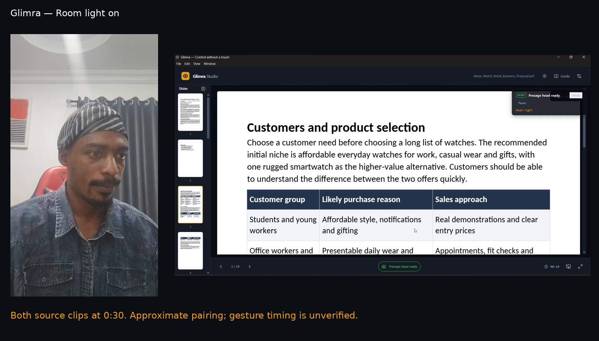
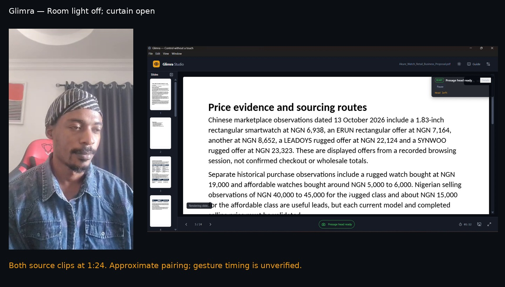
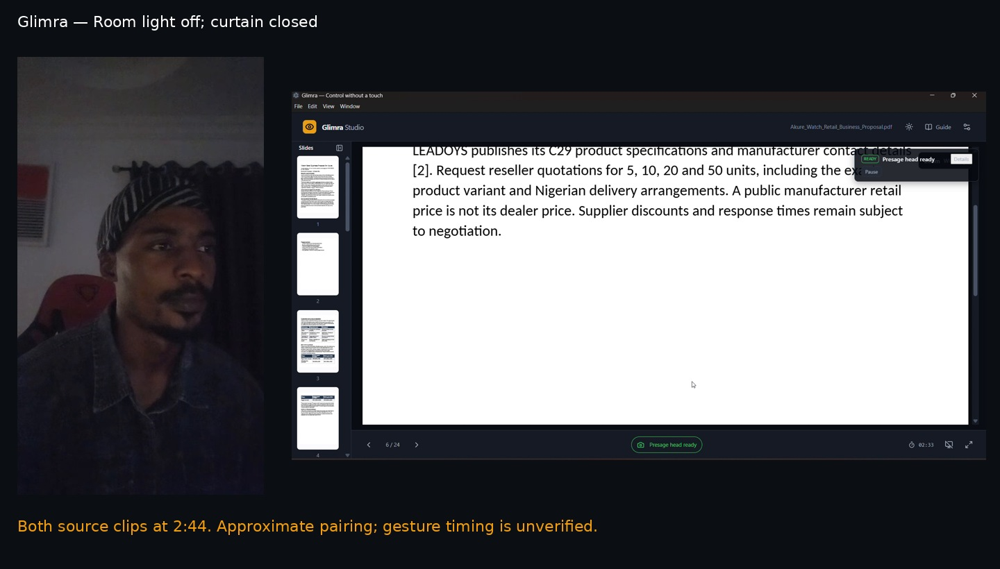

# Windows Head mode — lighting observations, November 20, 2026

The presenter supplied two recordings of one session: a 287.90-second portrait phone recording (`raaw gilmra phone recod.mp4`) and a 289.17-second desktop recording (`new video on glimra rw.mp4`). These observations document one person's setup. They support the project's feasibility investigation; the published accessibility research remains separate evidence.

## Conditions and observations

| Phone source range, approximate | Presenter-described condition | Visible observations and reported experience |
| --- | --- | --- |
| 0:00–0:50 | Room light on | Face is clearly lit. Head movements are visible. The desktop recording shows PDF navigation and scrolling during the session. |
| 1:15–2:10 | Room light off, curtain open | Face remains visible in daylight. Presenter reports that controls continued to work. |
| 2:15–2:55 | Room light off, curtain closed | Face is much darker. Presenter reports continued control with less sharp or consistent responses. PDF content changes during this part of the desktop recording. |

The earlier desktop frame at 2:30 displayed **Paused**. The replacement frame at 2:44 displays **Presage head ready**. The still cannot establish why it paused, whether pause was manual, or when active tracking returned. Treat continuous low-light tracking as unverified.

These ranges identify candidate excerpts, rather than exact lighting-switch timestamps. Some intervals include the presenter leaving the chair or changing the environment.

## Paired screenshots

Each image places the phone view beside a desktop frame at the same nominal source timestamp. The clips have different start times and have not been precisely synchronized. These are illustrative condition pairs; they do not prove which gesture caused a particular page change.

## Limits

- Windows is identified from the desktop capture. Camera model, distance, illuminance, exact application build, and SDK session diagnostics were not recorded with this test.
- The phone camera uses its own exposure. Phone image brightness is not a measurement of light reaching the laptop webcam.
- Screen light and other residual light may remain with the room light off. This does not establish operation in complete darkness.
- No scored attempts, response latency, false-command count, or failure rate were collected. “Less consistent” is the presenter's qualitative observation.
- The presenter stands up and returns in the recording. Automatic recovery requires a synchronized review of tracking status and actions before it can be marked verified.
- This session does not validate Eyes mode, performance for people with limited hand mobility, other users, or other cameras.

## Next verification

Synchronize the clips using a shared event and verify the offset at a second event. Count intended and accepted commands per condition, record the actual build and camera, and preserve failures and real response delays. Repeat with additional users and hardware before making broader reliability claims.
